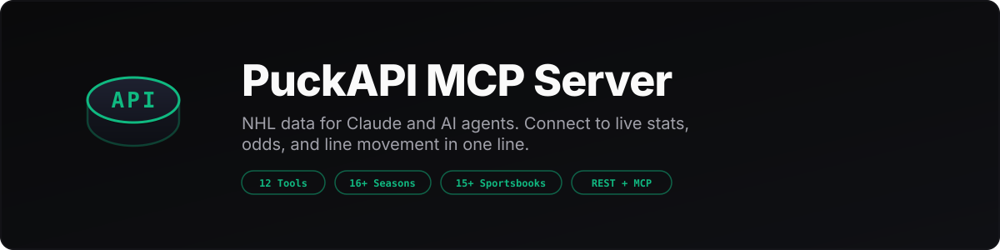

<div align="center">



<br>
<br>

**The hockey data API.** Stats, odds, and everything between.<br>REST API and MCP server. Free to start.

<br>

[](LICENSE)
[](#available-tools)
[](#data-coverage)
[](https://github.com/PuckAPI/claude-sports-analytics)
[](https://smithery.ai/servers/noahowsh/PuckAPI)

[Quick Start](#quick-start) · [Tools](#available-tools) · [Data](#data-coverage) · [Pricing](#pricing) · [REST API](#rest-api)

</div>

<br>

```
You:    "What were last night's NHL scores?"
Claude: [calls get_games → returns scores, periods, shots, goals]

You:    "Show me the line movement on the Sabres game"
Claude: [calls get_line_movement → opening line, current line, timestamps, book-by-book]

You:    "Compare McDavid and MacKinnon this season"
Claude: [calls get_player_stats x2 → side-by-side goals, assists, points, TOI, shooting %]
```

## Skills

17 Claude skills for hockey ship in this repo, plus 15 analytics skills for models, backtests, calibration and comparing a model with the market. Every number in an answer comes from a live PuckAPI tool call, and odds are information only: no stakes, no picks.

Claude Code:

```
/plugin marketplace add PuckAPI/mcp
/plugin install nhl-data@puckapi
/plugin install sports-analytics-core@puckapi
```

Codex: `codex plugin marketplace add PuckAPI/mcp`. Any agent that reads skills: `npx skills add PuckAPI/mcp`.

| Skill | What it does |
|---|---|
| `nhl-advanced-stats` | Corsi, Fenwick, xG, PDO, GSAx and the rest explained, with real numbers on request |
| `nhl-daily-slate` | Tonight's slate: each game's market probability beside our model, ranked by the gap |
| `nhl-game-lookup` | Find games by date, team, matchup or season: results, schedule and head-to-head history |
| `nhl-game-preview` | One-page preview: records and rest, the goalie matchup, key stats and the market probability |
| `nhl-goalie-analysis` | Goalies on shot-quality-adjusted numbers: goals saved above expected, high-danger save rate, form |
| `nhl-goalie-gsax-report` | A goals-saved-above-expected report from the goalie leaderboard, with rolling form |
| `nhl-odds-explorer` | Prices across books as implied and fair probability, with line movement |
| `nhl-player-props-research` | Prop lines by sportsbook, the player's record against his line and movement, as information |
| `nhl-player-scouting` | Player search, season stats, game logs, per-game rates and multi-season trends |
| `nhl-playoff-simulation` | Playoff chances by simulation from the standings, the schedule left and team ratings |
| `nhl-puckapi-tools` | Picks the right PuckAPI tool for a request and keeps track of credit cost |
| `nhl-research-workflow` | Four research patterns: exploration, hypothesis tests, model iteration and performance reports |
| `nhl-team-analysis` | Team standings, stats, strength of schedule and rankings |
| `nhl-totals-model` | A calibrated total-goals model for a game, compared with the market total as probability |
| `nhl-war-gar` | Player value from shift data: RAPM ridge regression toward WAR and GAR |
| `nhl-xg-model` | Train an expected-goals model on shot locations and events, with walk-forward validation |
| `nhl-xg-report` | The expected-goals story of a team or game: who deserved to win, and finishing against expected |

The analytics skills: `backtesting`, `data-pipeline`, `elo-engineering`, `feature-engineering`, `market-vs-model`, `model-building`, `nl-to-query`, `odds-market-analysis`, `prediction-tracker`, `probability-calibration`, `season-pack-offline`, `sports-data-preflight`, `sports-skill-router`, `visualization`, `walk-forward-validation`.

All nine sports' skills live in [sports-data-hq/sportsdatahq-skills](https://github.com/sports-data-hq/sportsdatahq-skills). The copies here are synced from there, so please open issues and pull requests there.

## Quick Start

**Claude Desktop** -- add to `claude_desktop_config.json`:

```json
{
  "mcpServers": {
    "puckapi": {
      "url": "https://mcp.puckapi.com/mcp?key=YOUR_API_KEY"
    }
  }
}
```

**Claude Code** -- one command:

```bash
claude mcp add --transport http puckapi \
  "https://mcp.puckapi.com/mcp?key=YOUR_API_KEY"
```

**Other MCP clients** -- any client supporting Streamable HTTP:

| Setting | Value |
|---------|-------|
| URL | `https://mcp.puckapi.com/mcp?key=YOUR_API_KEY` |
| Transport | Streamable HTTP |

<sub>Also accepts `Authorization: Bearer` or `x-api-key` headers. Connecting and listing tools works without a key; calling a tool needs one.</sub>

**Get your free key** at [puckapi.com](https://puckapi.com?utm_source=github&utm_medium=readme&utm_campaign=puckapi-mcp) -- 500 credits, no credit card.

---

## Starter projects

- [nhl-xg-model](https://github.com/noahowsh/nhl-xg-model): a season of shot locations to a calibrated expected-goals model, in one Python script.

## Use it in

- **Claude, ChatGPT, Cursor, VS Code, Gemini CLI, Grok, Perplexity, Le Chat:** add `https://mcp.puckapi.com/mcp` as a remote MCP server. Step-by-step for each: https://puckapi.com/mcp?utm_source=github&utm_medium=readme&utm_campaign=puckapi-mcp
- **Cursor:** the [SportsDataHQ plugins for Cursor](https://github.com/noahowsh/sportsdatahq-cursor-plugins)
- **Google Sheets:** `=SDHQ("puckapi","list_teams")` fills a live table: https://sportsdatahq.com/sheets?utm_source=github&utm_medium=readme&utm_campaign=puckapi-mcp
- **Claude Code skills:** [28 free NHL analytics skills](https://github.com/PuckAPI/claude-sports-analytics)
- **REST:** `POST https://mcp.puckapi.com/v1/<tool>` with an `x-api-key` header: https://puckapi.com/docs?utm_source=github&utm_medium=readme&utm_campaign=puckapi-mcp

## Available Tools

28 tools. Credits per call in the second column.

| Tool | Credits | What it returns |
|------|---------|-----------------|
| `list_teams` | 1 | Use when you need team abbreviations, or to see all 32 active NHL teams with city, conference, division, and arena. |
| `get_schedule` | 2 | Use when checking what games are coming up. |
| `get_standings` | 2 | Use when checking where teams rank in their division or conference. |
| `search_players` | 2 | Use when looking up a player by name. |
| `get_game_probabilities` | 5 | Use for what the market thinks of one game, not any one book's price: the average implied probability (margin in) and the fair probability (margin out) for the moneyline, each puck line and each total, with how many books each rests on. |
| `get_games` | 5 | Use when querying past or future games with filters. |
| `get_goalie_stats` | 5 | Use when ranking goalies or comparing goalie performance. |
| `get_player_game_log` | 5 | Use when you need a player's game-by-game stat lines for a season, not a season total. |
| `get_player_stats` | 5 | Use when you need full details for one player: bio, team, and physical attributes. |
| `get_predictions` | 5 | Use for the model's win probability for each NHL game on the current slate: home and away win probability, the A/B/C confidence grade, start time, plus the model version and when the slate was generated. |
| `get_skater_season_stats` | 5 | Use when ranking skaters or comparing scoring. |
| `get_team_stats` | 5 | Use when you need full details for one team: record, goals for and against, league rank, and 5v5 possession (Corsi%, Fenwick%, expected goals for and against). |
| `get_alt_lines` | 10 | Use for alternate puck lines and totals by sportsbook: every point on each book's ladder with its price (e.g. -2.5 at +250, over 7.5 at +160), for one game. |
| `get_game_detail` | 10 | Use when you need everything about one game: both teams' full info, all betting odds, and the goalies who started, with their time on ice. |
| `get_head_to_head` | 10 | Use when comparing two teams' history. |
| `get_market_odds` | 10 | Use for the extra betting markets of a game as history: the regulation result (three-way, a draw is possible), the 1st period result and puck line, and the 1st, 2nd and 3rd period totals. |
| `get_odds` | 10 | Use when checking betting lines. |
| `get_player_props` | 10 | Use for player prop lines by sportsbook: over/under on points, goals, assists, shots on goal, blocked shots, goalie saves, power-play points, anytime and first goal scorer, from May 2023 (DraftKings, FanDuel, BetMGM, ESPN BET, Pinnacle and others). |
| `get_plays` | 10 | Use for play-by-play events: goals, shots, misses, blocks, faceoffs, hits, giveaways, takeaways, penalties, with rink coordinates, strength state (5v5, 5v4), zone, and the players involved. |
| `get_prop_history` | 10 | Use to see how a player did against his prop line over time: for one market (points, goals, assists, shots on goal, blocked shots, goalie saves, power-play points, or anytime or first goal scorer), one row per game with the closing line (the median across books, or one book's), the opening line (the same as the close wherever only one capture was taken), the prices, what the player actually recorded from our box scores and the result against the line, plus the over rate, up to 200 games a call. |
| `get_prop_movement` | 10 | Use to see how one player's prop line moved before a game: every capture we hold, book by book and oldest first, with the line, both prices and the minutes before the start. line_change is the last capture's line minus the first's. |
| `get_prop_probabilities` | 10 | Use for what the market thinks of the player props in one game, not any one book's price: for each player and each line, the average implied probability (margin in) and the fair probability (margin out), with how many books each rests on. |
| `get_shifts` | 10 | Use for who was on the ice and when: every player's shifts in one NHL game, each with period, start and end (period clock and seconds from the opening faceoff) and duration, plus the official boxscore time on ice and plus/minus. |
| `get_shot_map` | 10 | Use when you want shot locations rather than a list of events: every shot attempt with rink coordinates, shot type, strength, shooter and goalie. |
| `get_situation_time` | 10 | Use for exact time at each strength: the seconds each team spent at 5v5, 5v4, 4v5, 4v4, 6v5 with the goalie pulled and every other on-ice state in an NHL game, split into regulation and overtime, from the shift charts. |
| `get_line_movement` | 25 | Use when analyzing how betting lines moved over time. |
| `get_prop_backtest` | 25 | Use to test an idea about player props without pulling every row: how often a kind of prop went over or under against what the market implied, across every finished game we hold prices for that fits your filters. |
| `get_prop_projections` | 25 | Paid plans only (not available on the free plan). |

## Data Coverage

| Category | Details |
|----------|---------|
| **Games** | 23,000+ across 16 seasons |
| **Play-by-play** | Every event since 2010-11 with rink coordinates (6.8M+ events) |
| **Odds** | Every game from 2019-20: about 12-14 books a game for 2020-21 to 2023-24, 60+ in 2025-26, and 8 books including Pinnacle captured hourly from October 2026 |
| **Line movement** | Hourly snapshots from September 2026 |
| **Players** | 4,800+ skaters and goalies |
| **Computed** | Expected goals, GSAX, Corsi and Fenwick |
| **PWHL** | Games, standings, play-by-play and shot locations; pass `league: "pwhl"` ([details](https://puckapi.com/pwhl?utm_source=github&utm_medium=readme&utm_campaign=puckapi-mcp)) |
| **Updates** | Games daily; odds captured hourly |

Live coverage by season: [historical odds](https://puckapi.com/data/historical-odds?utm_source=github&utm_medium=readme&utm_campaign=puckapi-mcp) · [play-by-play](https://puckapi.com/data/play-by-play?utm_source=github&utm_medium=readme&utm_campaign=puckapi-mcp) · [shot data](https://puckapi.com/data/shot-data?utm_source=github&utm_medium=readme&utm_campaign=puckapi-mcp)

---

## Pricing

| Plan | Credits/mo | Price |
|------|-----------|-------|
| **Free** | 500 every month | $0 |
| **Starter** | 10,000 | $19/mo |
| **Pro** | 30,000 | $49/mo |
| **Scale** | 125,000 | $149/mo |

Tools cost 1 to 25 credits a call ([per-tool costs](https://puckapi.com/pricing?utm_source=github&utm_medium=readme&utm_campaign=puckapi-mcp)). Wallet top-ups from $5 never expire.

---

## REST API

PuckAPI also offers a standard REST API:

```bash
curl -X POST https://mcp.puckapi.com/v1/get_standings \
  -H "x-api-key: YOUR_API_KEY"
```

Full documentation at [puckapi.com/docs](https://puckapi.com/docs?utm_source=github&utm_medium=readme&utm_campaign=puckapi-mcp).

---

## Used by

[PuckCast](https://puckcast.ai/), our NHL predictions site, runs on this API.

## Related

| | |
|---|---|
| **[PuckAPI Skills](https://github.com/PuckAPI/claude-sports-analytics)** | 28 free Claude Code skills for hockey analytics, betting models, and research |
| **[puckapi.com](https://puckapi.com?utm_source=github&utm_medium=readme&utm_campaign=puckapi-mcp)** | Sign up, dashboard, API docs |
| **[NHL odds tonight](https://puckapi.com/odds?utm_source=github&utm_medium=readme&utm_campaign=puckapi-mcp)** | Every tracked sportsbook's moneyline, puck line and total, refreshed hourly |
| **[NHL player props today](https://puckapi.com/props?utm_source=github&utm_medium=readme&utm_campaign=puckapi-mcp)** | Points, goals, shots, saves and anytime scorer: the consensus line and the best over and under price per player |
| **[Shots on goal prop history](https://puckapi.com/guides/nhl-shots-on-goal-prop-history-python?utm_source=github&utm_medium=readme&utm_campaign=puckapi-mcp)** | How often a player goes over his shots line, game by game, in Python |

### Other sports, same tools and key format

| | |
|---|---|
| **[EndzoneAPI](https://github.com/noahowsh/endzoneapi-mcp)** | NFL and college football |
| **[DunkAPI](https://github.com/noahowsh/dunkapi-mcp)** | NBA, WNBA and college basketball |
| **[FastballAPI](https://github.com/noahowsh/fastballapi-mcp)** | MLB and college baseball |
| **[StrikerAPI](https://github.com/noahowsh/strikerapi-mcp)** | Soccer, 17 competitions |
| **[AcesAPI](https://github.com/noahowsh/acesapi-mcp)** | ATP and WTA tennis |
| **[BirdieAPI](https://github.com/noahowsh/birdieapi-mcp)** | PGA Tour and other golf tours |
| **[FighterAPI](https://github.com/noahowsh/fighterapi-mcp)** | UFC, PFL and Bellator |

---

<div align="center">

**[puckapi.com](https://puckapi.com?utm_source=github&utm_medium=readme&utm_campaign=puckapi-mcp)** · **[API Docs](https://puckapi.com/docs?utm_source=github&utm_medium=readme&utm_campaign=puckapi-mcp)** · **[Skills](https://github.com/PuckAPI/claude-sports-analytics)**

<sub>MIT License</sub>

</div>
